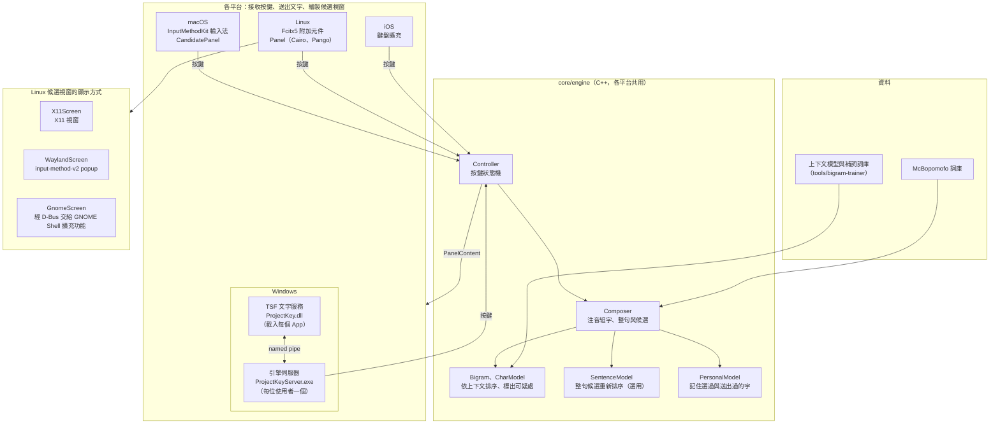
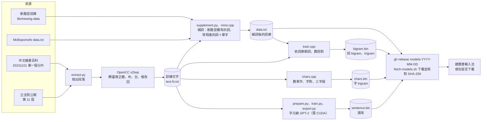

# Project Key

[](https://github.com/KoukeNeko/Project-Key/actions/workflows/ci.yml)
[](https://github.com/KoukeNeko/Project-Key/releases/latest)
[](LICENSE)

Project Key 為注音輸入法，macOS、Windows、Linux（Fcitx5）與 iOS 共用同一套組字引擎。整句可連續輸入後再一併選字；引擎依上下文排序候選，並標示可能選錯之處。


## 功能

### 組字

- **整句組字**：整句輸入完畢後一併選字。同音詞分數相近之處於整句預覽中標為可疑，按 Tab 於可疑處之間移動。
- **鍵盤排列**（macOS、Windows、Linux；iOS 為大千）：大千（預設）、倚天、許氏、倚天 26 鍵、IBM。許氏與倚天 26 鍵的聲調鍵兼作聲母，於完整音節之後按下時為聲調。以下範例皆依大千排列。
- **省略聲調**：拼成完整音節後，輸入位置較前的注音即開始下一個音節，並不分聲調比對，例如 ㄖㄣㄨㄟ 為「認為」；輸入音節結尾位置的注音則取代原注音，例如 ㄋㄧ 再按 ㄨ 為 ㄋㄨ。開啟設定中的「省略聲調」（預設關閉；macOS、Windows、Linux）後，後者改為開始下一個音節，例如 ㄕㄉㄜ 為「是的」。
- **注音順序容錯**（簡拼關閉時）：未依聲母、介音、韻母順序輸入的注音，於按下聲調鍵後合併為一個音節，例如 ㄧㄚㄐ 加一聲為 ㄐㄧㄚ、ㄛㄨㄗˋ 為 ㄗㄨㄛˋ。依輸入順序已構成詞語者不合併，例如 ㄨㄗˋ 仍為「污漬」。
- **簡拼**（預設關閉；macOS、Windows、Linux）：單一注音代表以其開頭的音節，例如 ㄨㄇ 為「我們」、ㄎㄧ 為「可以」；尚未結束的音節亦先轉為字。關閉時，於拼成完整音節前輸入已有注音的位置，即取代該注音。
- **近似音**（預設關閉；macOS、Windows、Linux）：一併列出 ㄓ/ㄗ、ㄔ/ㄘ、ㄕ/ㄙ、ㄣ/ㄥ、ㄢ/ㄤ 互換後的字，排在所輸入注音的字之後，不影響預設選字。
- **中英互轉**：於中文模式誤打成英文（如 hello），或於英文模式誤打成注音（如 ji3cl3）時，按 Tab 轉換。英文轉注音須含聲調鍵，因此不適用於許氏與倚天 26 鍵。
- **接續前文選字**：組字時參考游標前的漢字，不視為句首（macOS、Linux、iOS）。

### 符號與全形

以下功能適用於 macOS、Windows 與 Linux。

- **符號表**：按反引號鍵（`` ` ``）開啟符號表，按大寫字母切換至該字母的清單。
- **表情符號**：按 `~` 依分類開啟表情符號表，於分類中按 Esc 返回分類清單。輸入詞語時，候選詞之後亦列出對應的表情符號；資料取自 Unicode CLDR 的繁體中文註解。
- **全形輸入**：按 Shift+Space 切換全形與半形（可於設定關閉）。模式標示同時顯示語言與寬度，例如「ㄅ半」「Ａ全」。

### 詞庫與學習

以下功能適用於 macOS、Windows 與 Linux。

- **自訂詞**：選字時按 `+`，將反白的候選加入 `phrases.txt`；近似音的字不可加入。組字時以 Shift+←、Shift+→ 選取兩個以上已有聲調的音節，按 Enter 即將其加入為詞。
- **排除詞**：選字時按兩次 Delete（無 Delete 鍵的鍵盤可按 Shift+Backspace），將反白的候選寫入 `exclude-phrases.txt`，此後不再列出。
- **還原**：以 `+` 加入或排除後，立即按 Backspace 即撤銷該次變更。
- **記住選過的字**：相同上下文下優先選取曾選過的字，並自送出的文字學習常用說法；學習結果隨輸入量增加逐步淡化。資料僅存於本機，詳見各平台 README。

## 安裝

| 平台 | 安裝方式 | 說明 |
|---|---|---|
| macOS（Apple 晶片） | `brew install --cask koukeneko/tap/project-key` | [platforms/macos](platforms/macos/README.md) |
| Windows（x64） | `scoop bucket add koukeneko https://github.com/KoukeNeko/scoop-bucket`<br>`scoop install koukeneko/project-key` | [platforms/windows](platforms/windows/README.md) |
| Linux（Fcitx5） | `brew install koukeneko/tap/fcitx5-projectkey`<br>`projectkey-link` | 須先安裝相依套件；Debian、Ubuntu、Fedora 另有 apt 與 dnf 套件庫，詳見 [platforms/linux](platforms/linux/README.md) |
| iOS 17 以上 | 從原始碼建置 | [platforms/ios](platforms/ios/README.md) |

安裝完成後開啟歡迎視窗：按「加入」將 Project Key 加入系統輸入法，切換後即可於視窗中試打（Linux 須於重新啟動 Fcitx5 後執行 `projectkey-settings --welcome`）。亦可於系統的輸入法設定中自行加入：macOS 為「系統設定 > 鍵盤 > 輸入方式」，Windows 為「設定 > 時間與語言 > 語言與地區 > 中文（台灣）> 語言選項 > 新增鍵盤」，Linux 為 Fcitx5 設定的「輸入法」。

發行版附有[上下文模型](#上下文模型)與補充詞彙後的詞庫，選字依上下文排序。這些資料檔另有授權（CC BY-SA 4.0 與 LGPL-2.1-or-later），詳見 [THIRD_PARTY_NOTICES.md](THIRD_PARTY_NOTICES.md)。

## 常用按鍵

| 狀態 | 按鍵 | 動作 |
|---|---|---|
| 組字中 | Space | 結束一聲音節；無未完成的注音時開啟候選 |
| | ↓ | 開啟候選 |
| | Tab | 依整句預覽送出整句 |
| | Enter | 送出整句 |
| | Shift+←、Shift+→ | 選取音節；選取後按 Enter 加入自訂詞 |
| | `` ` ``、`~` | 開啟符號表、表情符號表 |
| 選字中 | 1–9 | 選取該列的字（每列欄數可設為 6 至 9，預設 6） |
| | Tab | 移至下一個可疑處 |
| | `+` | 將反白的候選加入自訂詞 |
| | Delete 或 Shift+Backspace | 排除反白的候選（按兩次） |
| | Backspace | 加入或排除後立即按下時撤銷；其餘情況關閉候選 |
| 任何時候 | 單按 Shift | 切換中文與英文 |
| | Shift+Space | 切換全形與半形 |
| 候選視窗 | 滑鼠點選候選字 | 選取該字（iOS 為觸控） |
| | 滑鼠點選列尾的頁碼或箭頭 | 展開或收合候選格線（macOS、Windows、Linux） |

完整按鍵表見各平台 README。

## 從原始碼建置

| 平台 | 指令 | 需要 |
|---|---|---|
| macOS | `platforms/macos/build.sh`，再 `platforms/macos/install.sh` | Xcode 或 Command Line Tools、CMake，macOS 13 以上 |
| Windows | `platforms\windows\build.ps1`，再 `platforms\windows\install.ps1` | Visual Studio 2026（C++ 桌面開發）、.NET 10 SDK、uv |
| Linux | `platforms/linux/build.sh`，再 `sudo cmake --install platforms/linux/build` | CMake、Ninja、Fcitx5 與 Qt 等開發檔 |
| iOS | `platforms/ios/build.sh` | Xcode、XcodeGen |

建置腳本下載 [MCBOPOMOFO_COMMIT](MCBOPOMOFO_COMMIT) 指定版本的 McBopomofo，產生詞庫，編譯並執行引擎測試，產出位於各平台的 `build/`。

## 專案結構

```
core/engine/        組字、選字與按鍵邏輯，各平台共用；測試在 Tests/
platforms/macos/    InputMethodKit 輸入法
platforms/windows/  TSF 文字服務（ProjectKey.dll）與引擎伺服器（ProjectKeyServer.exe）
platforms/linux/    Fcitx5 附加元件、候選視窗、設定視窗與 GNOME Shell 擴充功能
platforms/ios/      鍵盤擴充
tools/              上下文模型訓練、選字評測與圖示產生
tests/corpus/       評測語料
distribution/       發行說明，由發行流程讀取
```

輸入法邏輯集中於共用引擎：各平台將按鍵交由 Controller 處理，再依 Controller 產生的 `PanelContent` 繪製候選視窗。



## 上下文模型

`tools/bigram-trainer` 以維基百科與立法院公報訓練下列兩個模型。建置時若模型檔存在即一併納入，發行版亦附有這兩個模型。

- `bigram.bin`：詞 bigram 與 trigram，依前兩個詞選字（約 190 MB）。
- `chars.bin`：字 trigram，補足詞模型未收錄的詞對（約 126 MB）。

```bash
platforms/macos/build.sh            # 先建置一次，取得 McBopomofo 的詞庫
tools/bigram-trainer/train.sh       # 下載訓練文字並訓練，約 10 分鐘
platforms/macos/build.sh            # 再建置一次，把模型放進 App
```

`tools/bigram-trainer/fetch-models.sh` 下載發行版所用的同一組檔案，無須自行訓練。新模型發布後，可於 macOS、Windows、Linux 設定的「關於 > 選字模型」下載，無須重新安裝。

選字評測工具位於 [tools/corpus-evaluator](tools/corpus-evaluator/)。

### 資料處理流程



### 整句模型（選用）

詞模型僅依據前兩個詞評分，出現次數極少的詞對可能取得過高的分數，例如將「網頁太單調了」選為「網液態單調了」。`sentence.bin` 為約 1,400 萬參數的字元級 GPT-2；組字器取分數最高的 10 個整句候選，依此模型評估整句的語言機率後重新排序。此檔案與上述兩個模型置於同一資料夾，建置時若存在即一併納入，發行版與 `fetch-models.sh` 亦包含此檔案；未提供時，選字結果與先前相同。

```bash
tools/bigram-trainer/train.sh                                               # 產生訓練文字
python3 -I tools/lm-trainer/prepare.py <資料目錄> < tools/bigram-trainer/.cache/text-200000000.txt
python tools/lm-trainer/train.py <資料目錄> <模型目錄> --size small            # 需要 CUDA，約 20 分鐘
python tools/lm-trainer/export.py <模型目錄> tools/bigram-trainer/.cache/sentence.bin
```

以維基百科第一個分片共 8,100 萬字訓練後，評測語料的整句正確數由 224/240 提升至 229/240；另以 2,000 句未參與訓練的維基百科句子評測，由 1,353 句提升至 1,448 句。於 Intel Core i7-12700K 上，每鍵處理時間的 P95 由約 1 毫秒增加至約 20 毫秒，記憶體用量最高約 85 MB。此用量超出 iOS 鍵盤擴充功能的限制，故 iOS 建置不納入此模型。

## 授權

Project Key 以 [MIT](LICENSE) 授權發布。詞庫與選字引擎源自 [McBopomofo](https://github.com/openvanilla/McBopomofo)（MIT）。發行版所附的上下文模型以 CC BY-SA 4.0 授權，補充詞彙後的詞庫以 LGPL-2.1-or-later 授權；上述資料檔、其他第三方內容及訓練文字的授權，詳見 [THIRD_PARTY_NOTICES.md](THIRD_PARTY_NOTICES.md)。
